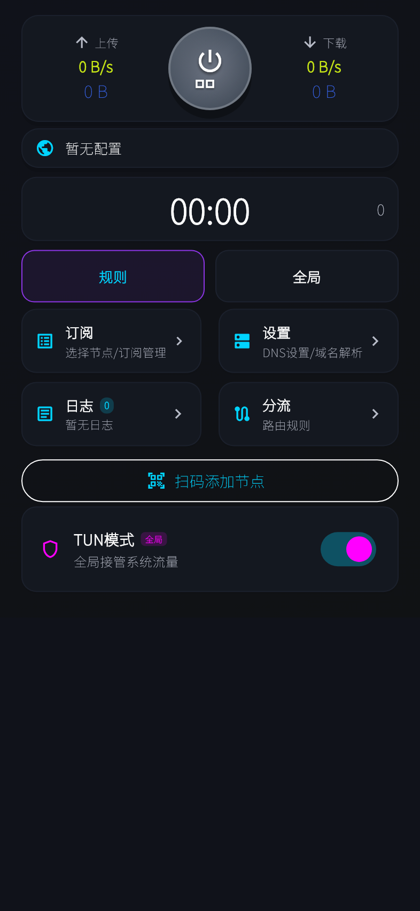
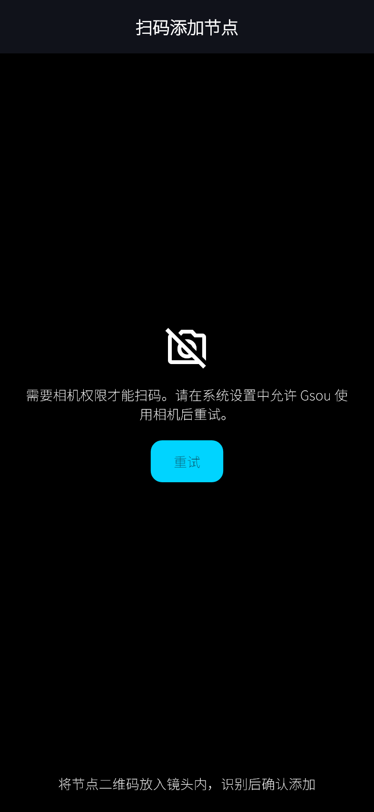

# 安卓扫码导入验证（2026-10-28）

## 变更与验证范围

安卓首页和订阅/分享链接页新增相机扫码入口，识别单个节点后确认添加。取消不保存，同一次扫描的重复回调只添加一次。无效文本不导入，拒绝相机权限时显示授权说明和重试入口。SS 导入补齐 SIP002 编码认证信息及密码含冒号的情况。

手机窄屏不再停留在加载动画；安卓隐藏 Windows 专用的系统代理、DMIT 监控与 VPS 出口管理入口。ARM64 内核使用 Go 1.25.5、sing-box 1.14.2 和 NDK r27 重新构建，构建脚本增加 16 KB ELF 对齐及 ARM64 打包选项。

## 检查结果

| 检查 | 结果 |
| --- | --- |
| `flutter test --coverage` | 99 通过、1 跳过；基线为 87 通过、1 跳过 |
| 新扫码页面覆盖率 | 64 / 67 可执行行，约 95.5% |
| 新扫码页及新增测试的 `flutter analyze` | 无问题；仓库既有页面仍有原有 lint 提示 |
| 变更 Dart 文件格式及 `git diff --check` | 通过 |
| `build_android_release.ps1 -Arm64` | Release APK 构建通过 |
| `build.ps1 -Mode release -SkipDLL` | 隔离源码目录 Windows Release 构建通过，复用现有 Windows 内核 |
| `apksigner verify` | v2 签名通过，当前仍使用 Android Debug 测试证书 |
| `zipalign -c -P 16 4` | 通过；所有打包 ELF 的 LOAD 段对齐不少于 16 KB |
| 原生库打包 | 仅含 `arm64-v8a`；源内核与合并产物、裁剪产物与 APK 内核哈希分别一致 |
| ASUS AI2501A 安装和启动 | 安装成功，启动状态正常，已安装 APK SHA-256 与本地一致 |

APK：`Gsou-1.0.4-20261028-android-arm64.apk`，73,398,422 字节，包名 `com.example.gsou`，最低 Android 7（API 24）。

SHA-256：`709b710103f52620976ff734b5e9f51b0ad76ac001fef233427e5c224e149127`。

本次真机检查仅证明安装和启动；相机实际识别、后台返回后的相机恢复及 VPN 联网仍待真机验证。现有 Windows VPN 进程未重启，未部署 Windows 构建产物。APK 与本机 SDK、签名密钥、完整运行日志均不纳入源码提交。

## 界面截图

以下是 Flutter Widget 渲染截图（393 × 852 逻辑像素），使用空配置和模拟相机权限拒绝，字体为测试替代字体；不代表真机相机测试结果，也不包含真实节点数据。

